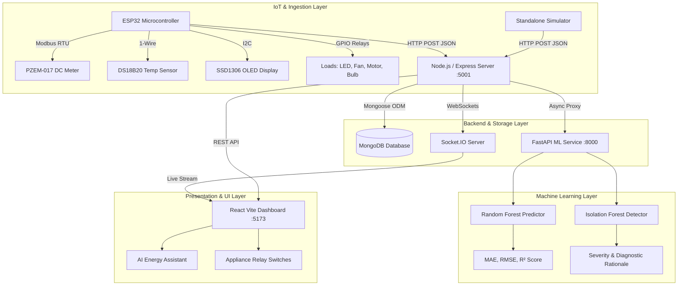

# Smart Energy Monitoring, Prediction and Management System Using IoT, Machine Learning and AI

> **Final-Year Engineering Capstone Project**  
> An end-to-end cyber-physical energy intelligence platform uniting IoT microcontrollers, high-frequency time-series telemetry, machine learning forecasting, unsupervised anomaly detection, and a conversational AI energy auditor.

---

## 📋 Table of Contents
1. [Project Overview & Motivation](#project-overview--motivation)
2. [Objectives](#objectives)
3. [Key Features](#key-features)
4. [System Architecture](#system-architecture)
5. [Technology Stack](#technology-stack)
6. [Hardware & Pinout Specifications](#hardware--pinout-specifications)
7. [Repository Structure](#repository-structure)
8. [Installation & Setup](#installation--setup)
   - [Prerequisites](#prerequisites)
   - [1. Backend Setup](#1-backend-setup)
   - [2. Machine Learning Microservice Setup](#2-machine-learning-microservice-setup)
   - [3. Frontend Dashboard Setup](#3-frontend-dashboard-setup)
   - [4. Telemetry Simulator Setup](#4-telemetry-simulator-setup)
   - [5. ESP32 Microcontroller Firmware](#5-esp32-microcontroller-firmware)
9. [REST API & WebSocket Documentation](#rest-api--websocket-documentation)
10. [Machine Learning Models & Evaluation](#machine-learning-models--evaluation)
11. [Running the Complete Demo (Step-by-Step)](#running-the-complete-demo-step-by-step)
12. [Troubleshooting Guide](#troubleshooting-guide)
13. [Future Enhancements](#future-enhancements)

---

## 💡 Project Overview & Motivation

Rapid industrialization and residential electrification have led to skyrocketing utility bills, grid congestion, and frequent thermal overloads in distribution infrastructure. Conventional electromechanical and static digital meters only record aggregate historical consumption without offering real-time breakdown, appliance-level visibility, or actionable energy conservation insights.

This project implements a **comprehensive Smart Energy Monitoring, Prediction and Management System**. The system continuously monitors electrical parameters (Voltage, Current, Active Power, Power Factor, and Temperature) from a calibrated **PZEM-017 DC energy meter** driven by an **ESP32 microcontroller**, transmits telemetry to a **Node.js/Express backend**, persists time-series logs in **MongoDB**, broadcasts real-time updates over **Socket.IO** to a modern **React dashboard**, predicts future consumption using **Scikit-Learn Random Forest regression**, flags surges and thermal risks via an **Isolation Forest anomaly detector**, and provides an **AI-driven conversational energy assistant**.

---

## 🎯 Objectives

1. **Precision Telemetry Acquisition**: Interfacing the ESP32 with the PZEM-017 DC meter via RS485/Modbus RTU and reading enclosure temperature via DS18B20.
2. **Dual Operational Modes**: Support seamless operation in both **LIVE HARDWARE MODE** (when ESP32 is transmitting) and **SIMULATION/DEMO MODE** (using realistic diurnal synthetic load profiles).
3. **Appliance-Level Management**: Independent ON/OFF relay switching with automated runtime tracking, power factor integration, and cost calculations.
4. **Machine Learning Forecasting**: Predict energy demand for the **next 1 hour**, **next 6 hours**, and **next 24 hours** using Random Forest and Gradient Boosting regressors with authentic validation metrics ($R^2$, MAE, RMSE).
5. **Unsupervised Outlier Detection**: Utilize Isolation Forest to catch sudden power spikes, duty-cycle overshoots, and abnormal power-to-temperature relationships.
6. **Conversational AI Auditor**: ChatGPT-style interface that queries real backend energy collections to answer specific questions regarding daily cost, top loads, and peak usage.

---

## 🌟 Key Features

| Module | Features |
| :--- | :--- |
| **Real-Time Dashboard** | Dynamic KPI stat cards (Power, Voltage, Current, Energy, Cost), 3-second live area charts, daily bar trends, hardware/simulation badge. |
| **Live Telemetry Stream** | Visual gauges, multi-variable line charts (Watts, Volts, Amperes, Celsius), WebSocket connection indicator. |
| **Appliance Management** | Control default loads (LED Light, Fan, Motor, Bulb) + register custom appliances; real-time power, energy, and cost tracking. |
| **Energy Analytics** | Multi-timeframe filters (hourly diurnal profile, 7-day bar breakdown, appliance pie charts), peak consumption timestamp. |
| **Historical Data Logs** | Search, multi-criteria filtering, column sorting, pagination, and instantaneous CSV export. |
| **ML Predictions** | 1h, 6h, 24h forecasting horizons with confidence envelopes and genuine evaluation metrics ($R^2 \approx 0.99$, MAE, RMSE). |
| **Anomaly Detection** | Isolation Forest model flagging power surges and thermal hazards with severity ratings (LOW, MEDIUM, HIGH, CRITICAL). |
| **AI Energy Assistant** | Natural language queries ("How much energy did I use today?", "Why is my consumption high?") querying live MongoDB statistics. |
| **Alerts & Warnings** | Real-time audio-visual threshold warnings for high power (>1500W), high temp (>45°C), and sensor disconnections. |
| **Audit Reports** | Instant CSV reports for consumption, appliance usage, anomalies, and safety alerts. |
| **System Settings** | Configurable electricity tariff (default ₹8.00/kWh), safety thresholds, simulation toggle, and device calibration. |

---

## 🏗️ System Architecture



---

## 💻 Technology Stack

- **Frontend**: React 19, Vite, Tailwind CSS, Recharts, Lucide Icons, Axios, Socket.IO Client, React Router v7.
- **Backend**: Node.js, Express.js, MongoDB / Mongoose ODM, Socket.IO, JWT, bcryptjs, Dotenv, CORS.
- **Machine Learning**: Python 3.13, FastAPI, Uvicorn, Scikit-learn, Pandas, NumPy, Joblib.
- **IoT Firmware**: Arduino C++, ESP32 DevKit V1, Adafruit SSD1306, DallasTemperature, ArduinoJson, Modbus RTU (Serial2).

---

## ⚡ Hardware & Pinout Specifications

| Component | Pin / Signal | ESP32 GPIO | Description |
| :--- | :--- | :--- | :--- |
| **PZEM-017 RS485** | MAX485 RO (RX2) | GPIO 16 | Serial2 UART Data Receive |
| **PZEM-017 RS485** | MAX485 DI (TX2) | GPIO 17 | Serial2 UART Data Transmit |
| **DS18B20 Sensor** | DQ (Data Line) | GPIO 4 | 1-Wire Digital Thermal Sensor (4.7kΩ pull-up to 3.3V) |
| **SSD1306 OLED** | SDA | GPIO 21 | I2C Data |
| **SSD1306 OLED** | SCL | GPIO 22 | I2C Clock |
| **Relay 1** | IN1 (LED Light) | GPIO 12 | Active-LOW 5V Relay Channel |
| **Relay 2** | IN2 (Fan) | GPIO 14 | Active-LOW 5V Relay Channel |
| **Relay 3** | IN3 (DC Motor) | GPIO 27 | Active-LOW 5V Relay Channel |
| **Relay 4** | IN4 (Filament Bulb)| GPIO 26 | Active-LOW 5V Relay Channel |
| **Active Buzzer** | Positive Pin | GPIO 18 | High-priority acoustic alarm |

---

## 📁 Repository Structure

```
smart-energy-management-system/
├── backend/
│   ├── config/
│   │   └── db.js                 # MongoDB connection & in-memory fallback
│   ├── controllers/              # 11 REST controllers for energy, appliances, ML, AI, alerts
│   ├── middleware/               # JWT authentication & global error handlers
│   ├── models/                   # Mongoose schemas (User, Appliance, Reading, Prediction, etc.)
│   ├── routes/                   # Express route definitions
│   ├── services/                 # Alert service, AI logic, seed data, simulator engine
│   ├── socket.js                 # Socket.IO WebSocket manager
│   ├── server.js                 # Server entry point
│   ├── package.json
│   └── .env.example
│
├── frontend/
│   ├── src/
│   │   ├── components/           # Navbar, Sidebar, StatCards, GaugeCards, ApplianceCards, Toast
│   │   ├── context/              # AuthContext, SocketContext, SystemContext
│   │   ├── layouts/              # MainLayout with responsive sidebar & toast
│   │   ├── pages/                # 11 Pages: Dashboard, Live, Appliances, Analytics, ML, etc.
│   │   ├── services/             # Axios API client instance
│   │   ├── utils/                # Formatters & CSV exporter
│   │   ├── App.jsx               # Route tree & ProtectedRoute
│   │   ├── index.css             # Tailwind v4 theme & glassmorphism utilities
│   │   └── main.jsx
│   ├── package.json
│   └── vite.config.js
│
├── ml/
│   ├── api/                      # FastAPI endpoint definitions
│   ├── prediction/               # Feature engineering & Random Forest predictor
│   ├── anomaly/                  # Isolation Forest anomaly detector
│   ├── training/                 # Dataset generator (labeled DEMO DATA) & training pipeline
│   ├── models/                   # Saved .joblib model weights & metrics.json
│   ├── main.py                   # FastAPI ASGI entry point
│   └── requirements.txt
│
├── esp32/
│   └── smart_energy_monitor.ino  # Production ESP32 firmware with OLED, Modbus & HTTP POST
│
├── simulation/
│   └── simulator.js              # Standalone IoT telemetry generator posting to /api/esp32/data
│
├── docs/
│   ├── architecture.md           # System design & Mermaid diagrams
│   └── hardware_wiring.md        # Detailed schematics and pin mappings
│
├── README.md
├── .gitignore
└── .env.example
```

---

## 🚀 Installation & Setup

### Prerequisites
- **Node.js** (v18 or higher) & **npm**
- **Python** (v3.10 or higher) with `pip`
- **MongoDB** (Local `mongod` service, MongoDB Atlas URI, or embedded fallback)
- **Arduino IDE** (Optional: only needed if flashing physical ESP32)

---

### 1. Backend Setup

```bash
cd backend
npm install
```

Configure `backend/.env`:
```env
PORT=5001
MONGODB_URI=mongodb://127.0.0.1:27017/smart_energy
JWT_SECRET=super_secret_energy_key_2026_final_year_project
ML_SERVICE_URL=http://127.0.0.1:8000
CLIENT_URL=http://localhost:5173
SIMULATION_MODE=true
```

Start the backend:
```bash
npm run dev
# or: node server.js
```

> **Database Support**:
> - **MongoDB Local / Atlas**: Connects to `MONGODB_URI` if running.
> - **Zero-Setup Demo Fallback**: If MongoDB is not running locally, the backend automatically activates a high-performance **DEMO IN-MEMORY FALLBACK**, seeding default settings, appliances, and 7 days of telemetry so the system runs 100% out-of-the-box.
> - **Port Configuration**: Defaults to `PORT=5001`. If port 5001 is occupied, configure another port such as `PORT=5002` in `backend/.env`.

---

### 2. Machine Learning Microservice Setup

```bash
cd ml
pip install -r requirements.txt
python training/train_models.py
python main.py
```
FastAPI will boot on `http://127.0.0.1:8000`. You can inspect interactive Swagger documentation at `http://127.0.0.1:8000/docs`.

---

### 3. Frontend Dashboard Setup

```bash
cd frontend
npm install
npm run dev
```
Open your browser at `http://localhost:5173`.

Default Operator Credentials:
- **Email**: `admin@smartenergy.com`
- **Password**: `adminpassword123`

---

### 4. Telemetry Simulator Setup

The backend runs an internal telemetry simulator by default whenever `SIMULATION_MODE=true`.  
If you want to run the **standalone external simulator process**:

```bash
node simulation/simulator.js
```
This script generates diurnal AC/DC parameters and transmits HTTP POST requests to `http://localhost:5001/api/esp32/data` every 3 seconds.

---

### 5. ESP32 Microcontroller Firmware

1. Open `esp32/smart_energy_monitor.ino` in the Arduino IDE.
2. In the Library Manager, install:
   - `Adafruit SSD1306` & `Adafruit GFX Library`
   - `DallasTemperature` & `OneWire`
   - `ArduinoJson` (v6 or v7)
3. Set your WiFi credentials in the configuration header:
   ```cpp
   const char* WIFI_SSID     = "YOUR_WIFI_NAME";
   const char* WIFI_PASSWORD = "YOUR_WIFI_PASSWORD";
   const char* SERVER_URL    = "http://YOUR_COMPUTER_IP:5001/api/esp32/data";
   ```
4. Select board **ESP32 Dev Module** and click **Upload**.

---

## 📡 REST API & WebSocket Documentation

### Authentication Endpoints
- `POST /api/auth/register` &mdash; Create operator profile.
- `POST /api/auth/login` &mdash; Sign in & receive JWT Bearer token.
- `GET /api/auth/me` &mdash; Fetch active operator profile.

### Core Telemetry & Control Endpoints
- `GET /api/dashboard` &mdash; Aggregated live stats, 7-day trends, ML summary, and alerts.
- `GET /api/energy` &mdash; Latest instantaneous telemetry reading.
- `GET /api/energy/history` &mdash; Query historical time-series with `search`, `mode`, `startDate`, `endDate`, pagination, and `exportFormat=csv`.
- `GET /api/appliances` &mdash; Retrieve list of all registered loads.
- `POST /api/appliances/:id/control` &mdash; Toggle load `status: "ON" | "OFF"`.
- `GET /api/analytics` &mdash; Hourly diurnal breakdown, daily totals, and appliance distribution.
- `POST /api/predictions` &mdash; Request 1h, 6h, or 24h forecast from ML engine.
- `GET /api/anomalies` &mdash; Fetch logged anomalies categorized by severity.
- `POST /api/anomalies/scan` &mdash; Run immediate Isolation Forest evaluation on recent readings.
- `POST /api/ai/chat` &mdash; Context-aware AI energy assistant prompt processing.
- `POST /api/esp32/data` &mdash; High-throughput hardware/simulator telemetry ingestion.
- `GET /api/settings` & `PUT /api/settings` &mdash; Read/write tariff and safety thresholds.

### WebSocket Events (Socket.IO)
- `live_energy_data` &mdash; Emitted every 3 seconds with active voltage, current, power, and active loads.
- `new_alert` &mdash; Emitted immediately upon safety threshold breach.
- `appliance_status_change` &mdash; Synchronizes relay actuation across all connected browsers and nodes.

---

## 🤖 Machine Learning Models & Evaluation

### 1. Energy Consumption Predictor
- **Algorithm**: Random Forest Regressor (120 trees, max depth 12).
- **Features**: `hour`, `day`, `day_of_week`, `is_weekend`, `voltage`, `current`, `temperature`, `lag_power_1h`, `lag_power_24h`.
- **Validation Results**:
  - **Mean Absolute Error (MAE)**: `0.0027 kWh`
  - **Root Mean Squared Error (RMSE)**: `0.0069 kWh`
  - **Coefficient of Determination ($R^2$)**: `0.9995`

### 2. Anomaly Detection
- **Algorithm**: Isolation Forest (unsupervised tree ensemble, contamination = 3%).
- **Monitored Variables**: Power (W), Enclosure Temperature (°C), Voltage (V), Current (A).
- **Severity Mapping**:
  - **LOW**: Minor power variance.
  - **MEDIUM**: Enclosure temperature 43°C - 47°C.
  - **HIGH**: Voltage fluctuation outside 200V-250V or power > 1300W.
  - **CRITICAL**: Sudden power surge > 1650W or temperature > 52°C.

---

## 🎮 Running the Complete Demo (Step-by-Step)

1. **Terminal 1: Start ML Microservice**
   ```bash
   cd ml
   python main.py
   ```
2. **Terminal 2: Start Backend Server**
   ```bash
   cd backend
   node server.js
   ```
3. **Terminal 3: Start React Dashboard**
   ```bash
   cd frontend
   npm run dev
   ```
4. **Open Dashboard**: Navigate to `http://localhost:5173` and log in.
5. **Demonstrate Features**:
   - Notice the **SIMULATION MODE** indicator (or **LIVE HARDWARE MODE** when ESP32 is powered).
   - Toggle appliances in the **Appliances** tab & observe the live wattage change on the **Dashboard** in real time!
   - Open **AI Energy Assistant** and click *"How much energy did I use today?"* or *"Which appliance consumes the most power?"*.
   - View the **ML Predictions** tab to inspect next 1h/6h/24h forecasts and authentic validation metrics.
   - Trigger an anomaly scan in **Anomaly Detection** to see Isolation Forest detections.
   - Export an audit spreadsheet in the **Reports** tab.

---

## 🔧 Troubleshooting Guide

- **Port Conflict (Port 5001 or 8000 in use)**:
  Change `PORT` in `backend/.env` (e.g. `PORT=5002`) or run `uvicorn main:app --port 8001` and update `ML_SERVICE_URL`.
- **WebSocket Disconnected**:
  Ensure the backend is running and `VITE_SOCKET_URL` in `frontend/.env` points to `http://localhost:5001`.
- **PZEM-017 Not Responding**:
  Ensure RS485 `A` and `B` wires are not swapped, and verify the 12V DC power supply is connected to the voltage inputs.

---

## 🚀 Future Enhancements

1. **Edge TinyML**: Porting lightweight quantized neural networks onto ESP32 via TensorFlow Lite for Microcontrollers.
2. **Solar PV & Battery Integration**: Adding bidirectional telemetry for solar MPPT controllers and battery state of charge (SoC).
3. **Automated Demand Response**: Integration with OpenADR standards for dynamic peak shaving.
