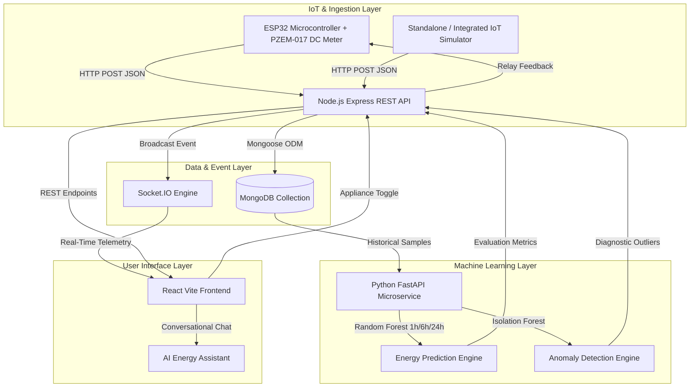

# System Architecture & Technical Specifications

## Smart Energy Monitoring, Prediction and Management System Using IoT, Machine Learning and AI

---

### 1. High-Level Architecture Overview

The system bridges physical electrical telemetry with cloud database persistence, high-frequency WebSockets, machine learning regression models, and an AI conversational agent.

---

### 2. Core Functional Layers

#### Layer 1: Hardware & Sensing Layer
- **ESP32 DevKit V1**: Acts as the central IoT gateway.
- **PZEM-017 DC Energy Meter**: Interfaced via UART2 (GPIO 16 RX, GPIO 17 TX) using Modbus RTU protocol. Accurately measures:
  - Voltage (0.05V - 300V DC)
  - Current (0.02A - 100A DC via external shunt)
  - Power (0.1W - 30kW)
  - Cumulative Energy (0 - 9999kWh)
- **DS18B20 1-Wire Sensor**: Monitors electronics enclosure temperature (GPIO 4).
- **SSD1306 0.96" OLED**: Real-time display showing WiFi state, Voltage, Current, Power, Energy, and Overload status.
- **Relay Actuators**: 4-channel active-LOW relay controlling loads (LED, Fan, Motor, Bulb).

#### Layer 2: Ingestion & Backend Server
- **Runtime**: Node.js & Express.
- **Database**: MongoDB with Mongoose ODM (optimized compound indexes on `{ timestamp: -1, mode: 1 }`).
- **Real-Time Layer**: Socket.IO bi-directional WebSocket server broadcasting `live_energy_data`, `new_alert`, and `appliance_status_change`.
- **Security**: JWT authentication, bcrypt password hashing, input validation, environment variable isolation.

#### Layer 3: Machine Learning Microservice
- **Framework**: Python 3, FastAPI, Uvicorn.
- **Algorithms**:
  1. **Random Forest Regressor & Gradient Boosting**: Trained on multi-variable diurnal features (`hour`, `day`, `day_of_week`, `is_weekend`, `voltage`, `current`, `temperature`, `lag_power_1h`, `lag_power_24h`). Outputs forecasts for 1-hour, 6-hour, and 24-hour horizons along with MAE, RMSE, and R² scores.
  2. **Isolation Forest**: Unsupervised anomaly detection flagging power spikes, thermal anomalies, and abnormal duty cycles.

#### Layer 4: Interactive React Dashboard
- Built with React, Vite, and Tailwind CSS.
- Interactive Recharts data visualizations for live power stream, 7-day bar charts, and appliance distribution pies.
- ChatGPT-style AI Energy Assistant answering real-time energy audits, bill reduction strategies, and predictions.
